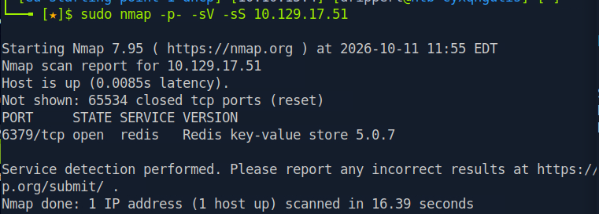
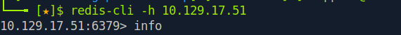

# ctf-writeups
This is my personal journey for CTFs

Hackthebox Lab: Redeemer

Redeemer is a very easy Linux machine which explores the enumeration and exploitation of a Redis database server while showcasing the redis-cli command line utility and basic commands to interact with the Redis service.

Task 1
Which TCP port is open on the machine? 6379 is open

sudo nmap -p- -sV -sS <target_IP>

Starting Nmap 7.95 ( https://nmap.org ) at 2026-10-11 11:55 EDT
Nmap scan report for 10.129.17.51
Host is up (0.0085s latency).
Not shown: 65534 closed tcp ports (reset)
PORT     STATE SERVICE VERSION
6379/tcp open  redis   Redis key-value store 5.0.7

Service detection performed. Please report any incorrect results at https://nmap.org/submit/ .
Nmap done: 1 IP address (1 host up) scanned in 16.39 seconds
--------------------------------------------------------------
Task 2
Which service is running on the port that is open on the machine? redis

sudo nmap -p- -sV -sS <target-ip>

Starting Nmap 7.95 ( https://nmap.org ) at 2026-10-11 11:55 EDT
Nmap scan report for 10.129.17.51
Host is up (0.0085s latency).
Not shown: 65534 closed tcp ports (reset)
PORT     STATE SERVICE VERSION
6379/tcp open  redis   Redis key-value store 5.0.7

Service detection performed. Please report any incorrect results at https://nmap.org/submit/ .
Nmap done: 1 IP address (1 host up) scanned in 16.39 seconds
--------------------------------------------------------------
Task 3
What type of database is Redis? Choose from the following options: (i) In-memory Database, (ii) Traditional Database

Answer: googling redis database -> In-memory Database
--------------------------------------------------------------
Task 4
Which command-line utility is used to interact with the Redis server? Enter the program name you would enter into the terminal without any arguments.

Answer: googlinng command-line utility used is -> redis-cli
--------------------------------------------------------------
Task 5
Which flag is used with the Redis command-line utility to specify the hostname?

Answer: googling Redis command-line utility to specify the hostname -> -h
--------------------------------------------------------------
Task 6
Once connected to a Redis server, which command is used to obtain the information and statistics about the Redis server?

googling hich command is used to obtain the information and statistics about the Redis server?
Answer: info
--------------------------------------------------------------
Task 7
What is the version of the Redis server being used on the target machine?

sudo nmap -p- -sV -sS <target-ip>

Starting Nmap 7.95 ( https://nmap.org ) at 2026-10-11 11:55 EDT
Nmap scan report for 10.129.17.51
Host is up (0.0085s latency).
Not shown: 65534 closed tcp ports (reset)
PORT     STATE SERVICE VERSION
6379/tcp open  redis   Redis key-value store 5.0.7

Answer: After scanning the target under services -> 5.0.7
--------------------------------------------------------------
Task 8
Which command is used to select the desired database in Redis?

googling Redis database Which command is used to select the desired database in Redis
Answer: select
--------------------------------------------------------------
Task 9
How many keys are present inside the database with index 0?

doing: connect to redis database first -> redis-cli -h <target_IP>
command-> info

Answer: 4
--------------------------------------------------------------
Task 10
Which command is used to obtain all the keys in a database?

doing: connect to the database:  redis-cli -h <target_IP>
doing: display information about the database: info
doing: then SELECT the databse where the key is stored, #Keyspace in this case it was <db0> -> SELECT 0
doing: then get the flag with: get flag

You have solved Redeemer!
